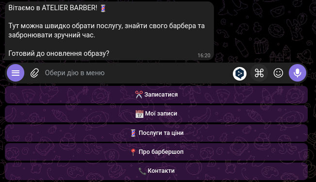
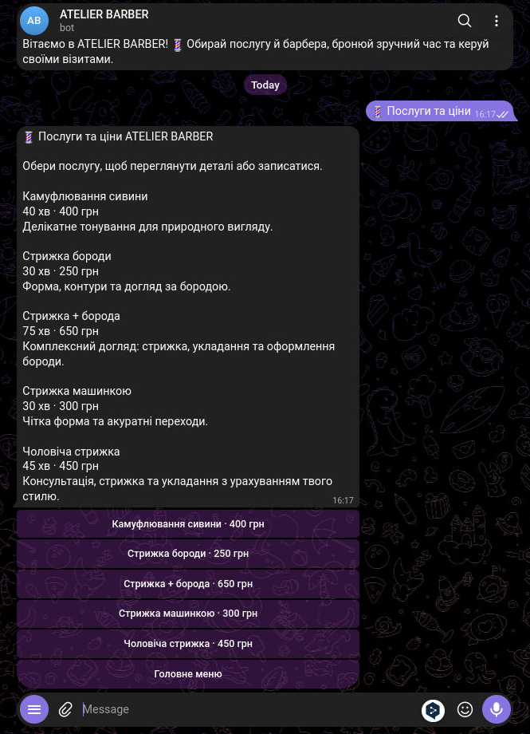
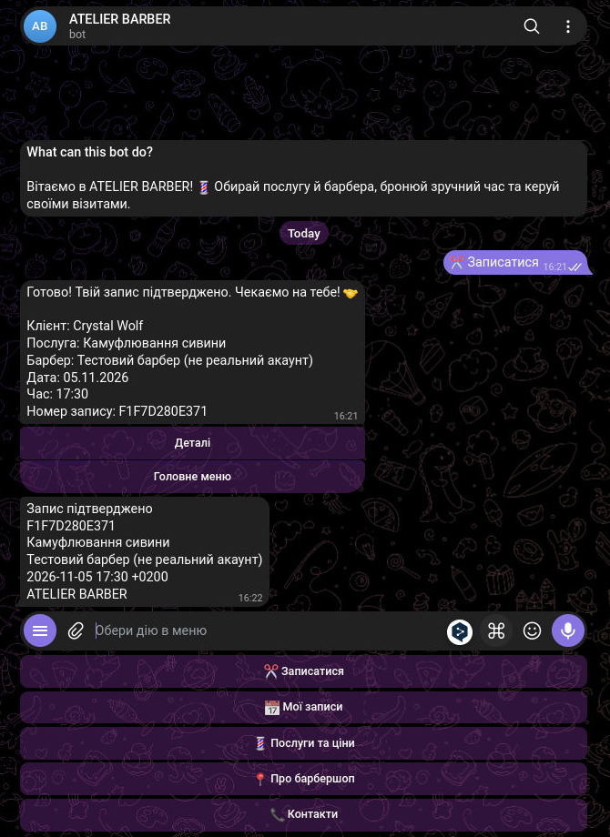
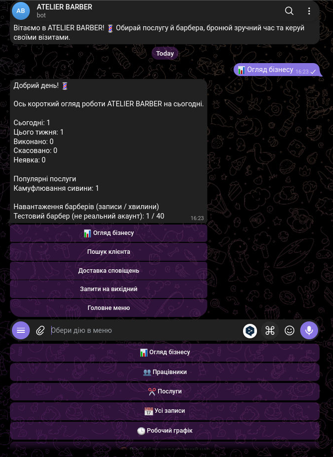
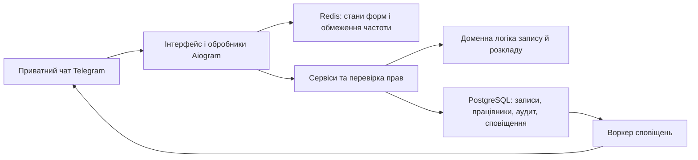

# ATELIER BARBER — Telegram-бот для запису до барбершопу

Система онлайн-запису та керування барбершопом у Telegram. Інтерфейс, повідомлення й перевірки введених даних — українською. Демонстраційні працівники, послуги та ціни вигадані й можуть бути змінені.

## Скриншоти

Приклади інтерфейсу клієнта й власника. Дані в кадрах демонстраційні.

| Меню клієнта | Послуги та ціни |
| --- | --- |
|  |  |

| Підтвердження запису | Огляд власника |
| --- | --- |
|  |  |

## Можливості

### Для клієнтів

- Перегляд послуг, описів, тривалості та цін.
- Запис до конкретного барбера або до будь-якого доступного працівника.
- Перегляд майбутніх і минулих записів.
- Скасування та перенесення власного запису відповідно до налаштувань закладу.
- Підтвердження із зазначенням послуги, барбера, часу та номера запису.

### Для барберів

- Перегляд розкладу на сьогодні, вибрану дату або найближчі сім днів.
- Перегляд профілю, послуг і робочих годин.
- Позначення завершених візитів і неявок після завершення часу запису.
- Особисті зміни розкладу, блокування часу, запити на відпустку та скасування записів — лише за дозволом власника.

### Для власника

- Керування працівниками, послугами, розкладом і налаштуваннями закладу.
- Перегляд і фільтрування всіх записів.
- Статистика за день, тиждень і довільний період.
- Пошук клієнтів і повторне надсилання невдалих сповіщень.
- Перенесення чи скасування записів із фіксацією причини.

Власник відкриває панель командою `/owner`. Команда `/menu` повертає до меню поточної ролі, а `/cancel` завершує заповнення форми. Якщо власник також має профіль барбера, він може перемикати вигляд командами `/barber`, `/owner` і `/customer`. Кожна дія окремо перевіряє права доступу.

## Запрошення працівників

1. Відкрийте `/owner` → **Працівники** → **Додати**.
2. Укажіть ім’я, спеціалізацію, послуги, робочі години та дозволи.
3. Перевірте дані й підтвердьте створення.
4. Створіть запрошення та передайте особисте посилання працівникові.

Запрошення містить випадковий криптографічно стійкий токен. У базі даних зберігається лише його SHA-256-хеш. Посилання діє 24 години, використовується один раз і скасовується під час повторного створення. Не публікуйте його у відкритому доступі. Обліковий запис Telegram прив’язується лише після активації запрошення самим працівником.

## Технології та архітектура

Python 3.12+, Aiogram 3, PostgreSQL, SQLAlchemy 2, Alembic, Redis, Pydantic Settings, Docker Compose.



Система враховує графік закладу й працівників, перерви, вихідні, винятки розкладу, часові пояси та переходи на літній час. База даних захищає від подвійного бронювання. Перенесення запису виконується атомарно, а зміни та дії адміністратора журналюються. Сповіщення надсилаються через транзакційну чергу з повторними спробами.

Докладніше: [архітектура](docs/ARCHITECTURE.md), [план реалізації](docs/IMPLEMENTATION_PLAN.md), [поточний стан](docs/PROGRESS.md).

## Встановлення

Створіть бота через BotFather і збережіть його токен у таємниці. Скопіюйте приклад конфігурації:

```bash
cp .env.example .env
```

У `.env` задайте `BOT_TOKEN`, надійний `POSTGRES_PASSWORD`, відповідний `DATABASE_URL` та `OWNER_TELEGRAM_ID` — числовий ідентифікатор власника Telegram. Не вказуйте ім’я користувача замість числового ідентифікатора. Файл `.env` не додається до Git.

Запустіть PostgreSQL і Redis, застосуйте міграції та створіть демонстраційні дані:

```bash
docker compose up -d postgres redis
docker compose run --rm migrate
docker compose --profile tools run --rm seed
docker compose up -d bot worker
```

Щоб запустити без Docker, установіть залежності командою `uv sync`, запустіть PostgreSQL і Redis та налаштуйте `.env`. Далі виконайте:

```bash
uv run alembic upgrade head
uv run python -m scripts.seed
uv run python -m appointment_booking.app.main
```

Для воркера сповіщень відкрийте окремий термінал і виконайте `uv run python -m appointment_booking.app.main --worker`.

Після запуску власник має написати боту, щоб активувати обліковий запис і отримувати сповіщення. Реальні назву, адресу та контакти закладу налаштуйте через панель власника. PostgreSQL і Redis використовують постійні томи; команда `docker compose down -v` видаляє їхні дані.

### Оновлення наявного встановлення

Зробіть резервну копію PostgreSQL, зупиніть бота й воркер, виконайте `alembic upgrade head`, а потім розгорніть відповідні версії програми. Міграції додають ролі, дозволи, запрошення працівників, особисті блокування та запити на відпустку. Вони не видаляють записи й не перезаписують власні налаштування послуг, цін і контактів.

## Демонстраційні дані

Команда `python -m scripts.seed` безпечна для повторного запуску й зберігає наявні послуги. Для нового встановлення додається демонстраційний профіль **«Тестовий барбер (не реальний акаунт)»** та вигадані послуги. Демодані не створюють реальних облікових записів Telegram чи записів клієнтів. Наявні ціни не змінюються автоматично.

## Перевірка якості

Тести інтеграції потребують окремої тестової бази PostgreSQL із назвою, що закінчується на `_test`, і окремої бази Redis. Налаштуйте `TEST_DATABASE_URL` та `TEST_REDIS_URL`, перш ніж запускати перевірки:

```bash
uv run pytest -q
uv run ruff check .
uv run ruff format --check .
uv run mypy appointment_booking
```

Перевірки не підміняють і не пропускають помилки, якщо необхідні тестові сервіси недоступні. CI додатково перевіряє міграції та повторне заповнення демонстраційних даних.

## Обмеження

Для реальної перевірки взаємодії з Telegram потрібні токен бота й обліковий запис. Сповіщення доставляються щонайменше один раз, тому аварійне завершення після успішного надсилання може призвести до дубліката. Немає оплати, зарплатного обліку чи масового перенесення записів. Демонстраційні послуги, ціни та працівник не є реальними даними закладу.
